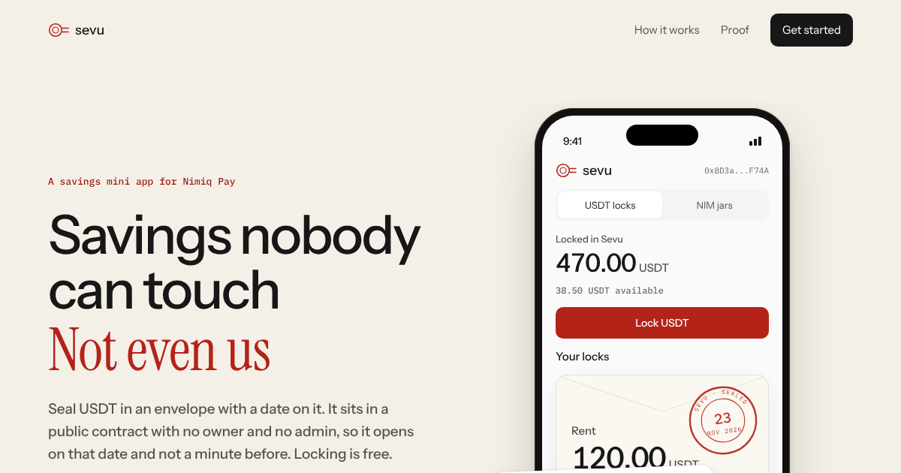

# Sevu

**Savings nobody can touch. Not even us.**

Sevu is a Nimiq Pay mini app that locks USDT until a date you choose. The money sits in a public contract on Polygon with no owner, no admin and no upgrade path. It opens on that date, and it only ever pays you.

[Open the live app](https://sevu.midelabs.xyz) · [Try to break it](https://sevu.midelabs.xyz/#/proof) · [Contract on Polygonscan](https://polygonscan.com/address/0x1500B1fB05C8CC4C432B91Bf18F7BEcdD780d170) · [Verified source](https://repo.sourcify.dev/137/0x1500B1fB05C8CC4C432B91Bf18F7BEcdD780d170)



## Check it in 30 seconds

Open the [proof page](https://sevu.midelabs.xyz/#/proof) in any browser, no wallet needed, and tap **Run the checks**. It asks the live contract two questions and shows the answers:

1. **Can a stranger withdraw a sealed lock early?** The contract refuses with `StillLocked` and the date it opens.
2. **Can anyone run admin functions?** `owner()`, `pause()`, `upgradeTo()`, `transferOwnership()` and `emergencyWithdraw()` do not exist on SevuLock.

Nothing is sent. The same page reads the totals straight from the contract each time it loads.

## The problem

Money in a wallet is always one tap from being spent. Savings apps fix that by holding your money for you, which means trusting whoever holds it not to freeze it, lose it or move it. Locking on-chain fixes the trust, but normally needs gas tokens and approvals that Nimiq Pay users don't have.

## How Sevu works

**Lock.** You pick an amount and a date, then sign twice in Nimiq Pay: a USDT0 permit (EIP-2612) and a lock intent (EIP-712) that names the owner, amount, unlock time, nonce and deadline. Sevu's relayer submits both in one transaction and pays the gas. Your wallet can hold zero POL.

**Wait.** The contract stores the lock. Before the unlock time, `withdraw` reverts for everyone, including Sevu.

**Open.** After the unlock time, anyone can call `withdraw`, and the contract sends the full amount to the lock's owner and nowhere else. The relayer does this for free. If the relayer is ever down, the app's **Withdraw directly** page calls the contract from your own wallet.

The relayer cannot change an amount, an owner or a date: the contract checks the owner's signature on every field. A relayer that disappears costs you nothing but convenience.

```
Nimiq Pay (your keys) ── signs permit + intent ──> Relayer (pays gas, validates, simulates)
        │                                                   │
        │ reads locks, withdraws directly if needed          │ depositWithPermit / withdraw
        └────────────────────> SevuLock on Polygon <─────────┘
                               no owner · no admin · pays only the owner
```

## Built on Nimiq

- **Nimiq Pay mini app.** Sevu runs inside Nimiq Pay through `@nimiq/mini-app-sdk`. Keys never leave the phone, and USDT locks use the Polygon wallet Nimiq Pay already holds.
- **NIM jars.** A second tab lets you name goals and stake NIM toward them through Nimiq Pay's staking methods. Jars read your real stake from the Nimiq chain, so a jar can never show more than you actually have staked. Jars lock nothing: you can unstake any time in Nimiq Pay.

## On-chain evidence

| What | Link |
|---|---|
| SevuLock (current) | [`0x1500B1fB05C8CC4C432B91Bf18F7BEcdD780d170`](https://polygonscan.com/address/0x1500B1fB05C8CC4C432B91Bf18F7BEcdD780d170) |
| Deploy transaction | [`0xb8a6…82c8`](https://polygonscan.com/tx/0xb8a6255c2ee9a452587e5b059d1a0212988bb762be65126c734f41340ce282c8) |
| Source match | [Sourcify](https://repo.sourcify.dev/137/0x1500B1fB05C8CC4C432B91Bf18F7BEcdD780d170) |
| First lock, sent from Nimiq Pay with 0 POL in the wallet | [`0xc0e3…aa10`](https://polygonscan.com/tx/0xc0e32301ec752ef22dbd47f74041c5da02b68b348aeabc0cbfecf00a32d2aa10) |
| Earlier SevuLock (same rules, holds that first lock) | [`0x27eb31d5783A3181Fadf39427eC45F552a6C00ef`](https://polygonscan.com/address/0x27eb31d5783A3181Fadf39427eC45F552a6C00ef) |

## Tested

| Layer | What runs | Result |
|---|---|---|
| Contract | Foundry unit and fuzz tests (1,000 runs), Polygon fork tests against real USDT0, Slither | 25 unit + 2 fork pass, 0 Slither findings at medium or above |
| Relayer | Unit tests plus integration against SevuLock on an anvil Polygon fork | 30 pass |
| App | Unit tests and a Playwright suite on an anvil fork: lock, refusal, withdraw, rescue, jars, accessibility on 17 screens | 20 unit, 39 end-to-end checks pass |

CI runs the contract, relayer and app tests on every push to `main`.

## Limits, on purpose

- 1 to 10 USDT per lock while Sevu is new. The cap lives in the relayer, not the contract.
- Unlock dates up to 2 years out. The shortest preset is 15 minutes, so anyone can try the whole loop in one sitting.
- The relayer has per-owner daily limits and a daily gas budget. When either runs out, locks wait a day; withdrawals still work directly.
- Nimiq Pay's `sendNewStakerTransaction` currently fails for some accounts ("expected instance of Address"). Sevu retries with the compact address format and explains the error when it still fails. Adding to an existing stake works.

## Run it locally

Requires Node 22, npm and [Foundry](https://getfoundry.sh).

```sh
git clone --recurse-submodules https://github.com/mystiquemide/sevu.git
cd sevu

# Contract
cd contracts && forge build && forge test && cd ..

# Relayer: set RELAYER_PRIVATE_KEY, POLYGON_RPC_URLS, SEVU_LOCK_ADDRESS, USDT0_ADDRESS, ALLOWED_ORIGINS
cd relayer && npm ci && cp .env.example .env && npm test && npm run dev

# App, in another terminal: set VITE_SEVU_LOCK_ADDRESS and VITE_RELAYER_URL
cd app && npm ci && cp .env.example .env && npm test && npm run dev

# Full end-to-end run on a Polygon fork (needs anvil and a Polygon RPC)
cd app && POLYGON_RPC=https://polygon-bor-rpc.publicnode.com npm run test:e2e
```

Outside Nimiq Pay the app shows its landing page. To use it, open it inside Nimiq Pay.

## Repository

```
contracts/   SevuLock.sol, Foundry tests, deploy script
relayer/     Hono + viem service that validates, simulates and pays gas; systemd and proxy configs
app/         Vue 3 mini app: locks, jars, proof page, landing page, unit and end-to-end tests
```

## Roadmap

Every item keeps the one rule: nothing opens early, and nothing pays anyone but the owner.

- **Raise the cap.** Move past 10 USDT per lock after an independent review of SevuLock.
- **Gold locks.** The same envelope for XAUt0, for savers who want to hold gold until a date.
- **Payday top-ups.** A reminder on your chosen day that opens a prefilled lock, so saving becomes a habit instead of a one-off.
- **Sealed for someone else.** Lock money that opens to a different wallet on a date, like school fees for a child or a gift.
- **Unlock alerts inside Nimiq Pay.** Use native notifications once mini apps can send them, instead of calendar reminders.

## Team

Built by [MystiqueMide](https://github.com/mystiquemide): smart contract, relayer, mini app, design and testing.

## License

[MIT](LICENSE)
